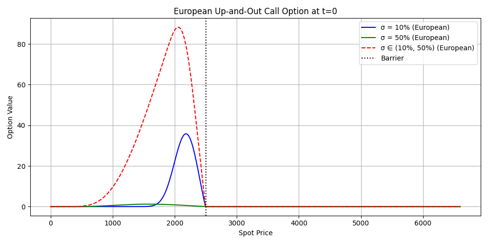
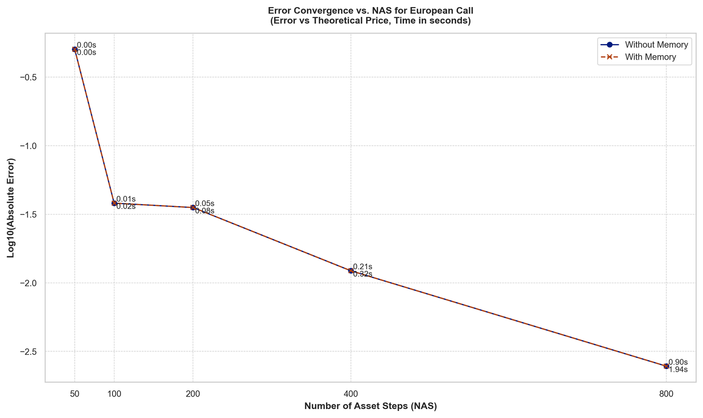
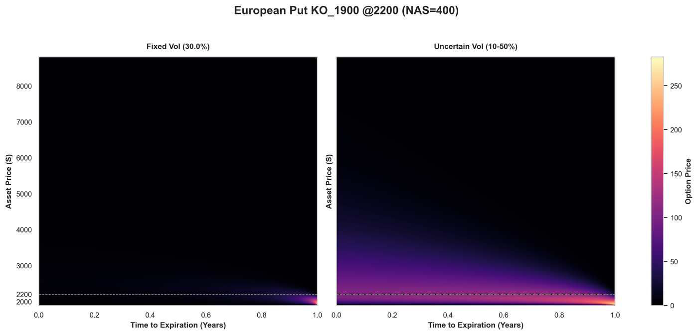

# Finite-Difference Pricing of Barrier Options under Uncertain Volatility

**Explicit finite-difference PDE solver for European and American knock-out options, extended to the Uncertain Volatility Model and a discrete cash dividend.**


Closed-form prices disappear once you add barriers, early exercise, an unknown volatility band and a jump in the underlying. This project solves the Black–Scholes PDE numerically on a grid. It prices four knock-out contracts (European/American × call/put) and studies how the worst-case volatility of the **Uncertain Volatility Model (UVM)** and a mid-life dividend reshape prices, gamma and the early-exercise region.

## Highlights

- **Explicit FD scheme** for the Black–Scholes PDE with call/put boundary conditions and an extrapolated boundary for Γ
- **Stability-driven grid design**: `δt = 0.9 / (σ² N_S²)` for vanilla options, and barrier-specific grid bounds and time steps for up-and-out and down-and-out contracts
- **Convergence study** of error vs. number of asset steps; `N_S = 400` chosen as the default. Two implementations compared: full grid in memory vs. a single rolling price vector
- **Uncertain Volatility Model**: nonlinear PDE where σ* switches between σ₋ and σ₊ depending on the sign of Γ (worst case for the option writer)
- **American exercise** via the early-exercise constraint, with maps of the optimal exercise region
- **Discrete dividend** (D = 500 mid-year) handled as a jump condition on the grid

## Findings

- With uncertain volatility, the price **exceeds the price at either end of the volatility band** for every spot level. A band of 20–30% gives a peak price of about 17 for the up-and-out call; widening it to 10–50% pushes the peak to about 90.
- For European knock-outs, higher volatility means a *lower* price because the barrier is hit more often. American knock-outs keep their value because they can be exercised just before the barrier.
- Γ-sign maps show where the writer must hedge against low rather than high volatility. This region is concentrated close to the barrier.
- An American call with a barrier is only exercised right before the barrier. For puts, lower volatility moves the exercise boundary earlier, and UVM removes that incentive.
- A dividend shifts the price surface by D at the payment date, which raises put values and lowers call values. For American puts it creates a second "heat source" exactly D above the barrier.

<p align="center">
  
  
</p>
<p align="center"><em>Left: up-and-out call at t = 0, fixed σ vs. UVM band (dashed). Right: error vs. grid resolution.</em></p>

<p align="center">
  
</p>
<p align="center"><em>Price surface (time to expiry × spot) of a down-and-out put: fixed σ vs. uncertain σ.</em></p>

## Repository structure

```
src/finite_difference/   fd.py (vanilla), fd_ko.py (knock-out + UVM), fd_ko_dividend.py,
                         pricing.py (analytical benchmark), interpolation.py
scripts/                 run_analysis + plots/ (heatmaps, error plots, exercise regions)
reports/                 full report (PDF, in Polish)
```

## How to run

```bash
python -m pip install -e .
python -m scripts.run_analysis
```

Smoke tests: `python -m unittest discover -s tests`.

## Report

📄 [Full report (PDF, Polish, 31 pages)](reports/projekt2_IF.pdf)

**Authors:** Maciej Karawan, Kacper Olczak. Financial Engineering I course project, May 2025.
